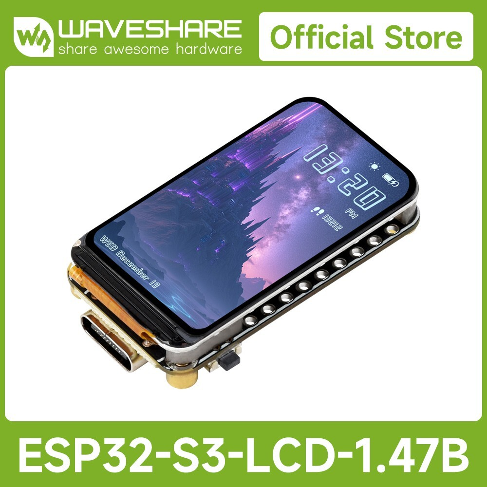

  <h1>ESP32-S3-LCD-1.47B</h1>
  
<strong>ESP32-S3 development board with a 1.47-inch 172 × 320 LCD</strong>

  
<strong>English</strong> | <a href="README_ZH.md">简体中文</a>

  

    
    
    
  

  

    <a href="https://www.waveshare.com/ESP32-S3-LCD-1.47B.htm">🛒 Product</a> &middot;
    <a href="firmware/">📦 Firmware</a> &middot;
    <a href="examples/esp-idf/">🧩 ESP-IDF</a> &middot;
    <a href="examples/arduino/examples/">🔧 Arduino</a> &middot;
    <a href="https://docs.waveshare.com/ESP32-S3-LCD-1.47B">📖 Documentation</a>
  

  

---

## ✨ Overview

ESP32-S3-LCD-1.47B combines an ESP32-S3 with a 1.47-inch ST7789 LCD, a microSD card slot, a QMI8658 six-axis IMU, RGB LED, and battery interface. This repository provides ESP-IDF and Arduino examples for the board.

| Feature | Device / interface |
| --- | --- |
| MCU | ESP32-S3 dual-core LX7, up to 240 MHz |
| Memory | 16 MB Flash, 8 MB PSRAM |
| Display | 1.47-inch, 172 × 320, ST7789, SPI |
| Touch | None |
| Peripherals | MicroSD, QMI8658 six-axis IMU, RGB LED, battery interface |

## 📦 Quick Start

The fastest way to try an example is a ready-to-flash package from the [latest release](https://github.com/waveshareteam/ESP32-S3-LCD-1.47B/releases/latest).

1. Download the `*-combined.zip` package for the example and framework version you need.
2. Extract the archive and install esptool with `python -m pip install esptool`.
3. Connect the board over USB.
4. Run `flash_combined.bat COMx` on Windows or `./flash_combined.sh /dev/ttyACM0` on Linux.
5. Reset the board if it does not restart automatically.

Factory firmware restores the out-of-box demo. Download [`ESP32-S3-LCD-1.47B_FactoryOnly_20260827.bin`](firmware/ESP32-S3-LCD-1.47B_FactoryOnly_20260827.bin) and follow the flashing instructions in [`firmware/README.md`](firmware/README.md).

## 🧪 Examples

### ESP-IDF

| Example | Main feature |
| --- | --- |
| [ESP32-S3-LCD-1.47B-Test](examples/esp-idf/ESP32-S3-LCD-1.47B-Test/) | LCD, LVGL, microSD, IMU, battery, RGB LED, and wireless demo |

### Arduino

| Example | Main feature |
| --- | --- |
| [LCD_Image](examples/arduino/examples/LCD_Image/) | Display PNG images from a microSD card |
| [LVGL_Arduino](examples/arduino/examples/LVGL_Arduino/) | LVGL interface with LCD, IMU, battery, microSD, RGB LED, and wireless modules |

Libraries used by the sketches are bundled in [`examples/arduino/libraries`](examples/arduino/libraries/).

## 🛠️ Development Environment

| Framework | Version | Examples |
| --- | --- | ---: |
| ESP-IDF | `v5.5.5`, `v6.0.2` | 1 |
| Arduino-ESP32 | `3.3.11` | 2 |

## 📚 Resources

- [Schematic (V1.2 PDF)](hardware/schematic/ESP32-S3-LCD-1.47B-Schematic-V1.2.pdf)
- [Product page](https://www.waveshare.com/ESP32-S3-LCD-1.47B.htm)
- [Wiki](https://docs.waveshare.com/ESP32-S3-LCD-1.47B)

## 🤝 Support

- Example or repository problem: [open an issue](https://github.com/waveshareteam/ESP32-S3-LCD-1.47B/issues/new/choose).
- Product usage, hardware, or order questions: [Waveshare support](https://service.waveshare.com/).

## 📄 License

Apache License 2.0. See [LICENSE](LICENSE).
