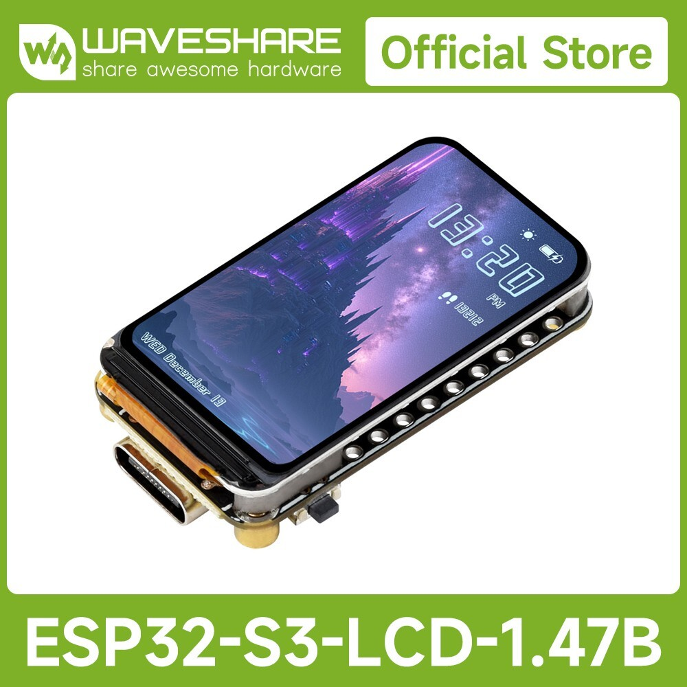

  <h1>ESP32-S3-LCD-1.47B</h1>
  
<strong>搭载 1.47 英寸 172 × 320 LCD 的 ESP32-S3 开发板</strong>

  
<a href="README.md">English</a> | <strong>简体中文</strong>

  

    
    
    
  

  

    <a href="https://www.waveshare.com/ESP32-S3-LCD-1.47B.htm">🛒 产品</a> &middot;
    <a href="firmware/">📦 固件</a> &middot;
    <a href="examples/esp-idf/">🧩 ESP-IDF</a> &middot;
    <a href="examples/arduino/examples/">🔧 Arduino</a> &middot;
    <a href="https://docs.waveshare.net/ESP32-S3-LCD-1.47B/">📖 文档</a>
  

  

---

## ✨ 概述

ESP32-S3-LCD-1.47B 集成 ESP32-S3、1.47 英寸 ST7789 LCD、MicroSD 卡槽、QMI8658 六轴 IMU、RGB 灯和电池接口。本仓库提供适用于该开发板的 ESP-IDF 和 Arduino 示例。

| 功能 | 器件或接口 |
| --- | --- |
| MCU | ESP32-S3 双核 LX7，最高 240 MHz |
| 存储器 | 16 MB Flash，8 MB PSRAM |
| 显示 | 1.47 英寸，172 × 320，ST7789，SPI |
| 触摸 | 无 |
| 外设 | MicroSD、QMI8658 六轴 IMU、RGB 灯、电池接口 |

## 📦 快速开始

体验示例最快的方法是使用[最新版本](https://github.com/waveshareteam/ESP32-S3-LCD-1.47B/releases/latest)中打包好的可烧录固件。

1. 下载所需示例和框架版本对应的 `*-combined.zip`。
2. 解压后通过 `python -m pip install esptool` 安装 esptool。
3. 通过 USB 连接开发板。
4. Windows 运行 `flash_combined.bat COMx`，Linux 运行 `./flash_combined.sh /dev/ttyACM0`。
5. 如果开发板未自动重启，请手动复位。

出厂固件用于恢复开箱演示。下载 [`ESP32-S3-LCD-1.47B_FactoryOnly_20260827.bin`](firmware/ESP32-S3-LCD-1.47B_FactoryOnly_20260827.bin)，并按照 [`firmware/README_ZH.md`](firmware/README_ZH.md) 的说明烧录。

## 🧪 示例

### ESP-IDF

| 示例 | 主要功能 |
| --- | --- |
| [ESP32-S3-LCD-1.47B-Test](examples/esp-idf/ESP32-S3-LCD-1.47B-Test/) | LCD、LVGL、MicroSD、IMU、电池、RGB 灯和无线演示 |

### Arduino

| 示例 | 主要功能 |
| --- | --- |
| [LCD_Image](examples/arduino/examples/LCD_Image/) | 从 MicroSD 卡显示 PNG 图片 |
| [LVGL_Arduino](examples/arduino/examples/LVGL_Arduino/) | 使用 LCD、IMU、电池、MicroSD、RGB 灯和无线模块的 LVGL 界面 |

草图使用的库随仓库提供，位于 [`examples/arduino/libraries`](examples/arduino/libraries/)。

## 🛠️ 开发环境

| 开发框架 | 版本 | 示例数 |
| --- | --- | ---: |
| ESP-IDF | `v5.5.5`、`v6.0.2` | 1 |
| Arduino-ESP32 | `3.3.11` | 2 |

## 📚 资料

- [产品页](https://www.waveshare.com/ESP32-S3-LCD-1.47B.htm)
- [Wiki](https://docs.waveshare.net/ESP32-S3-LCD-1.47B/)

## 🤝 支持

- 示例或仓库问题：[提交 issue](https://gitee.com/waveshare/ESP32-S3-LCD-1.47B/issues)。
- 产品使用、硬件或订单问题：[微雪技术支持](https://docs.waveshare.net/ESP32-S3-LCD-1.47B/Technical-Support/)。

## 📄 许可证

Apache License 2.0，详见 [LICENSE](LICENSE)。
